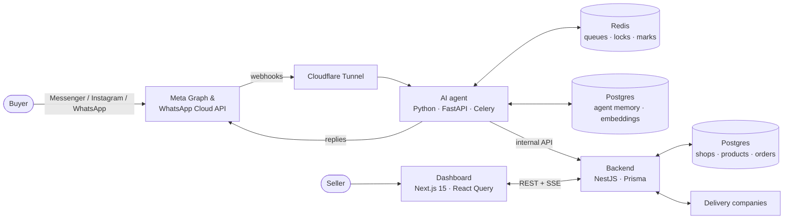
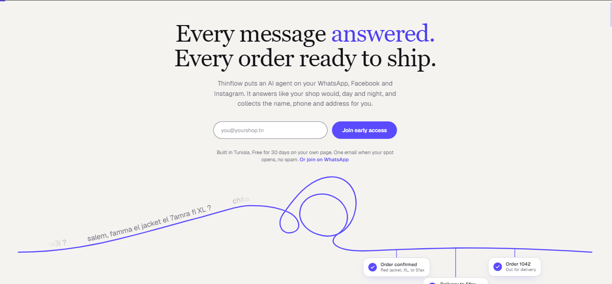
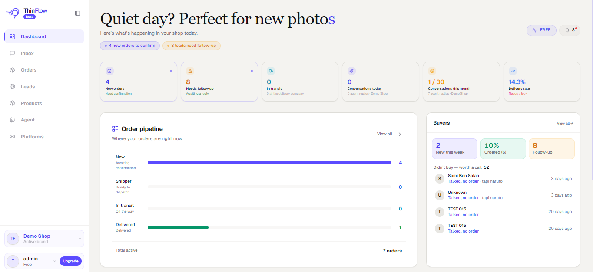
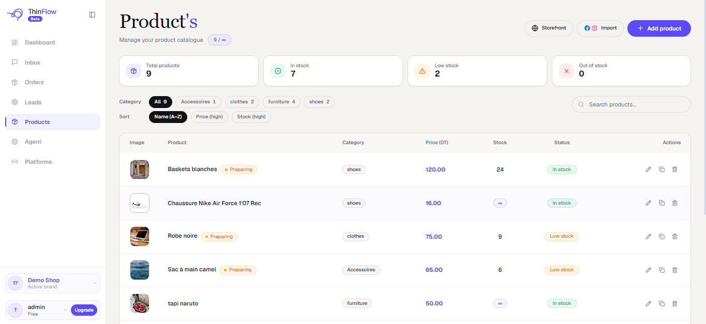

  

<h1 align="center">ThinFlow</h1>

  <b>An AI sales agent that answers Tunisian online shops' customers on Messenger, Instagram and WhatsApp, in Tunisian Arabic, and turns the chat into a confirmed order.</b>

  <b>Live app → <a href="https://beta.thinflow.co">beta.thinflow.co</a></b> · Early access, in production with real shops · <a href="#demo">Demo</a>

> This repository is a public showcase. The product's source code is private; this page explains what ThinFlow does, how it is built, and the engineering decisions behind it.

---

## The problem

In Tunisia, most online shops sell through Facebook and Instagram DMs, not through a website. Payment is cash on delivery, so a sale only exists once the shop has the buyer's **name, address and a correct phone number**.

A busy page receives thousands of messages a week: *"how much?"*, *"do you deliver to Gafsa?"*, a photo of a product, a voice note. Sellers answer by hand, late at night, and lose buyers who wait too long or give a wrong number.

## What ThinFlow does

| | |
|---|---|
| **Sales agent** | Answers buyers 24/7 in Tunisian derja, in Arabic letters or arabizi (*"9adech soum?"*), and in French. Recognises products from a buyer's photo, handles carts with several products (*"2 naruto w wa7da uno"*), collects name, address and phone, checks the number, and creates the order. |
| **Order agent** | For sellers who prefer to chat themselves: when the seller sends their own confirmation phrase, ThinFlow reads the conversation and prepares a draft order: products, quantities, address, phone. |
| **Seller dashboard** | Unified inbox, orders pipeline (pending → confirmed → delivery → returns), leads, product catalogue imported from the page's posts, delivery-company integration, team accounts, and ad attribution (which ad or post brought each order). Available in Arabic, French and English. |

## Architecture

| Layer | Stack |
|---|---|
| **AI agent** | Python 3.13, FastAPI, Celery, SQLAlchemy + Alembic, LangChain, DeepSeek, image embeddings for product matching, speech-to-text for voice notes |
| **Backend** | NestJS, Prisma, PostgreSQL (Supabase, row-level security), Server-Sent Events for live updates |
| **Dashboard** | Next.js 15, TypeScript, Tailwind, React Query, next-intl (ar / fr / en) |
| **Infrastructure** | Docker Compose on an Azure VM (agent, worker, API, Redis), Cloudflare Tunnel, Vercel for the dashboard, Sentry, Telegram alerting |

## Engineering highlights

- **The model never decides that an order happened.** The LLM classifies and writes; deterministic code owns prices, stock, cart operations and order creation. A price in a reply is always the catalogue's, never the model's.
- **Built for how Tunisians actually write.** Text normalisation folds Arabic letter variants, arabizi digits (3, 7, 9) and spelling drift. *"ok marhaba bik"* and *"Ok marhbe bik"* are matched by consonant skeleton, without a model call.
- **Cost and latency measured, not guessed.** About **0.04 DT per conversation** in production. Turning off the model's reasoning mode for order extraction cut a 20-message chat from about **60 s / 11,000 output tokens to about 2 s / 150 tokens**, with the same products extracted, verified on real conversations before shipping.
- **Multi-tenant by construction.** Every request is scoped to a workspace and a shop; the database also enforces row-level security.
- **Tested.** About **1,700 automated tests**: about 1,400 on the agent (pytest), about 300 on the API (Jest), and the dashboard's guards (Vitest), including a guard that fails CI when untranslated English slips into the Arabic dashboard.
- **Spec-driven.** 15 features were specified, planned and broken into tasks before code ([GitHub Spec Kit](https://github.com/github/spec-kit)): customer memory, product resolution, multi-product cart, order capture, Arabic dashboard and more.
- **Approved by Meta.** Passed Meta App Review for Messenger and Instagram messaging, and approved as a WhatsApp Tech Provider.

https://github.com/user-attachments/assets/15599f42-fca2-4335-80de-04df898f6dc6

**Landing page**: what the merchant sees first

**Seller dashboard**: orders to confirm, leads to follow up, order pipeline and buyers

**Product catalogue**: stock levels and categories, with import from Facebook and Instagram posts

## My role

I designed and built ThinFlow end to end: product, the three services, infrastructure and deployment. I run it in production with early merchant shops.

## Contact

**Iheb Brahmi** · [iheb.brahmi@isimg.tn](mailto:iheb.brahmi@isimg.tn) · [Upwork](https://www.upwork.com/freelancers/~015cf095f8851c09a3)

Open to internships and graduation-project positions, in Tunisia or abroad.
