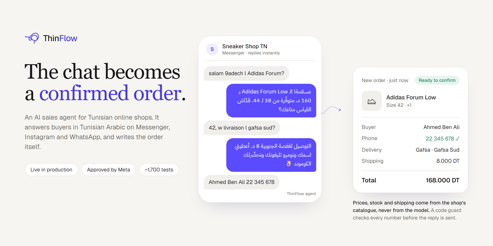
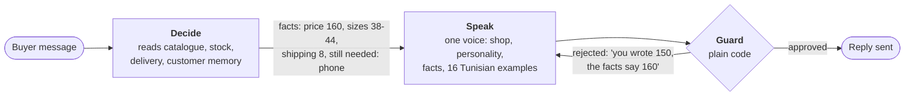
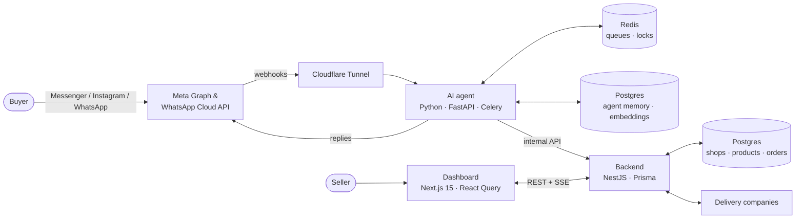
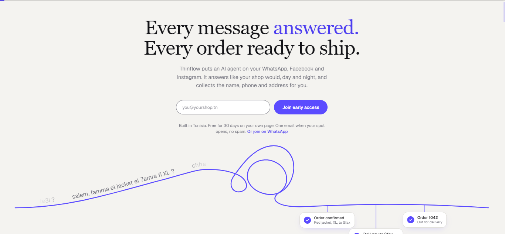
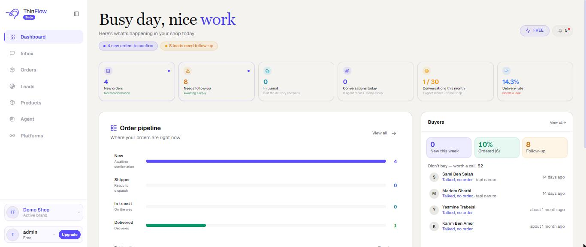
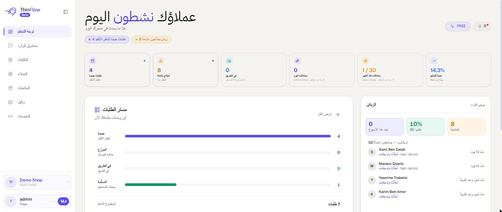
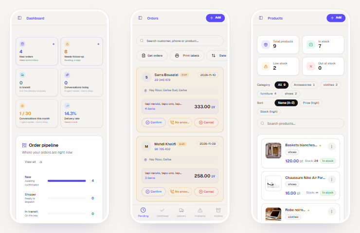
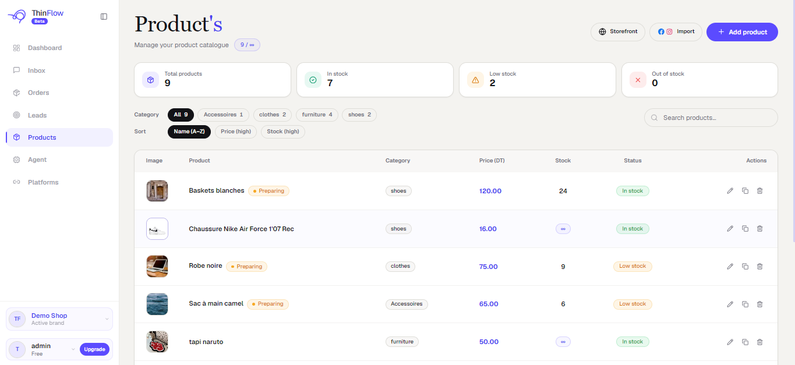

  

  <b>ThinFlow is an AI sales agent for Tunisian online shops.</b> 
  It answers buyers on Messenger, Instagram and WhatsApp in Tunisian Arabic, and turns the chat into an order.

  <a href="https://beta.thinflow.co"><b>Live app → beta.thinflow.co</b></a> · <a href="#demo">Watch the demo</a> · <a href="#two-problems-worth-telling">Engineering stories</a>

> The product's source code is private. This page shows what ThinFlow does, how it is built, and two problems I had to solve along the way.

| ~1,700 | 2 s | ~0.04 DT | 3 |
|:---:|:---:|:---:|:---:|
| automated tests | to read a whole chat and extract the order (was 60 s) | cost of one conversation in production | services, built and run alone |

## Demo

https://github.com/user-attachments/assets/15599f42-fca2-4335-80de-04df898f6dc6

## The problem

In Tunisia, most online shops sell through Facebook and Instagram messages, not a website. Payment is cash on delivery, so a sale only exists once the shop has the buyer's **name, address and a phone number that works**.

A busy page gets thousands of messages a week: *"9adech soum?"*, *"tewsel l Gafsa?"*, a photo of a product, a voice note. Sellers answer by hand, late at night, and lose the buyers who wait too long.

## What ThinFlow does

| | |
|---|---|
| **Sales agent** | Answers buyers 24/7 in Tunisian Arabic, written in Arabic letters or in Latin letters and digits (*"9adech soum?"*), and in French. Recognises a product from a buyer's photo, understands voice notes, handles carts with several products (*"2 naruto w wa7da uno"*), collects name, address and phone, and creates the order. |
| **Order agent** | For sellers who prefer to chat themselves: when the seller types their own confirmation phrase, ThinFlow reads the conversation and prepares the order for them. |
| **Seller dashboard** | One inbox for every channel, an order pipeline from pending to delivered, leads to follow up, a catalogue imported from the page's posts, delivery companies, team accounts, and which ad brought each order. In Arabic, French and English. |

## Two problems worth telling

### 1. The model decides nothing. It only speaks.

**The problem.** The first agent had three writers sharing one 3,000-character prompt. The shop's chosen personality was two lines inside it, so it barely showed. With the cheerful "Lively" personality selected, the agent still sent a plain price list without a single emoji. Worse, the prompt contradicted itself: one part asked for Tunisian Arabic in Latin letters, another for Arabic letters only. And nothing stopped the model from writing a price or a delivery fee of its own.

**What I built.** I split the agent in two, with plain code between them.

- **Decide** looks everything up and returns named facts. Every number in a reply comes from here, never from the model.
- **Speak** is a single voice that receives only the shop, the personality, the facts and the last lines of the chat. With nothing else to read, the dialect stays consistent and each personality reads clearly different.
- **Guard** is ordinary code that compares the outgoing message with the facts. When it finds a wrong number or an invented promise, it sends the draft back with the reason in plain words. It costs nothing when the reply is right, and gives the same verdict on the same sentence every time.

**The result.** No number in a reply comes from the model. The dialect is stable, and the merchant chooses between **five personalities** that really sound different. Each one is written as gestures rather than adjectives ("exactly one emoji, at the end"), because a model follows a gesture and ignores an adjective.

**What production taught me next.** On its first real run, "Lively" added *"black goes with every style"* to a correct answer. Nobody had said that, and the guard missed it because it contained no number. A made-up compliment is still a promise made in the shop's name. Since then, a selling point can only come from something written in the facts.

### 2. From 60 seconds to 2 seconds

**The problem.** The order agent reads a whole conversation and extracts the products, quantities, address and phone. On a 20-message chat it took about **60 seconds** and **11,000 output tokens**. The seller was waiting, and paying for it.

**What I found.** The model was in reasoning mode, thinking at length before writing a short structured answer it did not need to think about.

**What I did.** I turned reasoning off for this one task, then checked it on real conversations before shipping. The bar was the same products extracted, not "looks fine".

**The result.** About **2 seconds** and **150 tokens**, with the same products extracted.

## Architecture

| Layer | Stack |
|---|---|
| **AI agent** | Python 3.13, FastAPI, Celery, SQLAlchemy + Alembic, pydantic-ai, LangChain, DeepSeek, image embeddings for product matching, speech-to-text for voice notes |
| **Backend** | NestJS, Prisma, PostgreSQL (Supabase, row-level security), Server-Sent Events for live updates |
| **Dashboard** | Next.js 15, TypeScript, Tailwind, React Query, next-intl (Arabic, French, English) |
| **Infrastructure** | Docker Compose on an Azure VM, Cloudflare Tunnel, Vercel for the dashboard, Sentry, Telegram alerts |

## Engineering highlights

- **Built for how Tunisians actually write.** Text normalisation folds Arabic letter variants, the digits used as letters (3, 7, 9) and spelling drift. *"ok marhaba bik"* and *"Ok marhbe bik"* match on their consonants, without calling a model.
- **Learns new place names.** The 264 official delegations are matched by exact name, then known aliases, then edit distance. When a buyer confirms a misspelled place, that spelling becomes an alias, so the next buyer who writes it the same way is understood at once. An alias is tied to its governorate, because the same neighbourhood name exists in several cities, and the model's own guesses are never saved: only what a buyer confirmed.
- **Multi-tenant by construction.** Every request is scoped to a workspace and a shop, and the database also enforces row-level security.
- **Tested.** About 1,400 tests on the agent (pytest), 300 on the API (Jest), and the dashboard's guards (Vitest), including one that fails CI when untranslated English slips into the Arabic dashboard.
- **Spec-driven.** 15 features were specified, planned and broken into tasks before any code, with [GitHub Spec Kit](https://github.com/github/spec-kit): customer memory, product resolution, multi-product cart, order capture, the Arabic dashboard and more.
- **Approved by Meta.** Passed Meta App Review for Messenger and Instagram messaging, and approved as a WhatsApp Tech Provider.

## Screenshots

Taken from the demo shop. Buyer names and phone numbers are replaced with made-up ones.

**Landing page**

**Seller dashboard**: orders to confirm, leads to follow up, the order pipeline and recent buyers

**The same dashboard in Arabic**: written for merchants, not translated word for word

**On the phone**: most sellers run their shop from their phone

**Product catalogue**: stock, categories, and import from Facebook and Instagram posts

## My role

I designed and built ThinFlow alone, end to end: the product, the three services, the infrastructure and the deployment. I run it in production with early merchant shops.

## Contact

**Iheb Brahmi** · [iheb.brahmi@isimg.tn](mailto:iheb.brahmi@isimg.tn) · [LinkedIn](https://www.linkedin.com/in/iheb-brahmi/) · [Upwork](https://www.upwork.com/freelancers/~015cf095f8851c09a3)

Open to internships and graduation-project positions, in Tunisia or abroad.
